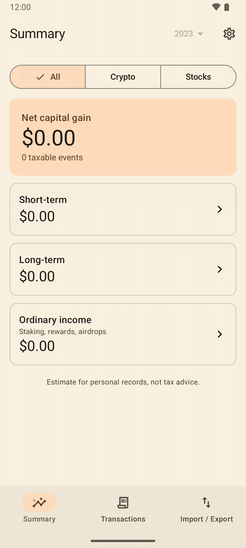
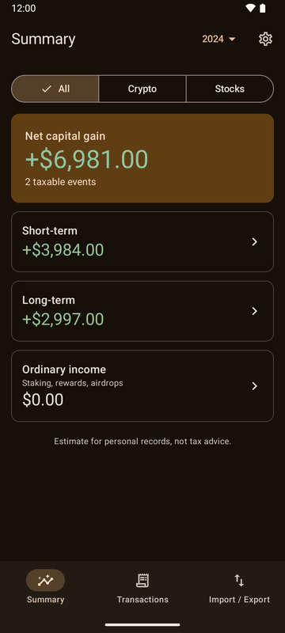
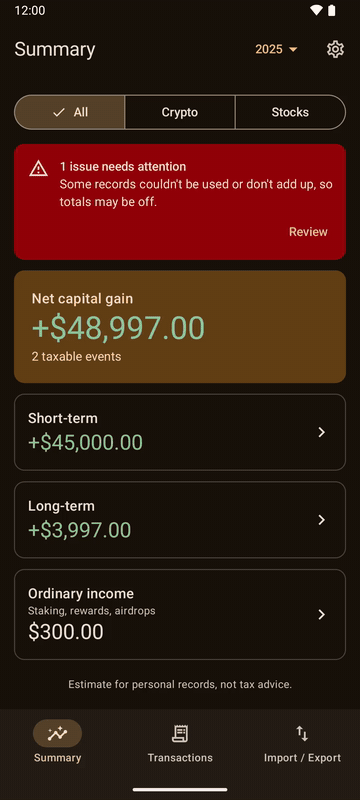
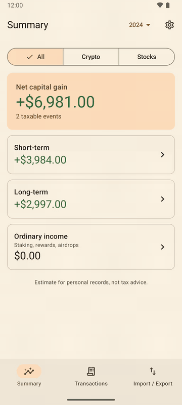

# BlockGains

**A private, offline Android app that works out your US capital gains and losses from your own transaction records.**

Crypto first, stocks planned. Built with Kotlin and Jetpack Compose (Material 3).

> **Tax disclaimer: BlockGains is an estimator for personal records, not tax advice.**
> Results can be wrong or incomplete, especially if your records are. Check them against your broker forms (1099-DA / 1099-B) and talk to a qualified tax professional or CPA before filing. Only US federal rules are modeled, and tax laws change.

**Contents:** [In action](#in-action) · [What it does](#what-it-does) · [Getting started](#getting-started) · [Privacy and storage](#privacy-and-storage) · [Known limitations](#known-limitations) · [Building](#building) · [License](#license)

## In action

<table>
  <tr>
    <td align="center" width="50%">
      
      <br><sub>Import a CSV and check the preview first</sub>
    </td>
    <td align="center" width="50%">
      
      <br><sub>Totals by tax year, traced back to the lots</sub>
    </td>
  </tr>
  <tr>
    <td align="center" width="50%">
      
      <br><sub>Assign what you held on January 1, 2025 to wallets</sub>
    </td>
    <td align="center" width="50%">
      
      <br><sub>Export Form 8949-style CSV and a PDF report</sub>
    </td>
  </tr>
</table>

---

## What it does

### Bring in your records

- **One CSV for everything.** The unified format holds any mix of assets, wallets and record types: buy, sell, swap, income, transfer, opening position and adjustment. Download a blank template from the app.
- **Preview before anything is saved.** See the rows to add, duplicates that will be skipped, problems with their line numbers, and any $0 buys to resolve.
- **Old v1 files still work.** Convert the two-file buys/sells format with `tools/legacy_to_unified.py` (see [`tools/README.md`](tools/README.md)).

### Calculate by the 2025 rules

- **FIFO that follows the wallet-by-wallet change.** Disposals before 2025 use one pool per asset. From January 1, 2025, each wallet has its own pool. The *Opening positions* helper assigns what you held on that date to wallets and keeps the original dates and basis.
- **Correct holding periods.** Long-term means held *more than* one year, counted from the day after purchase. Anniversaries and leap days are handled.
- **Fees, swaps, transfers, income and adjustments.** Buy fees add to basis, sale fees reduce proceeds, swaps are disposals, and staking or reward income is ordinary income.
- **Network fees on transfers.** Moving coins between your own wallets isn't taxable, but the coins paid as the network fee count as sold, so they can have a small gain or loss.

### See and share the results

- **Summary by tax year:** short-term, long-term, net and ordinary income, filtered by asset class.
- **Every number is traceable.** Tap a taxable event to see the exact lots it used and the rule that applied.
- **Problems are shown, not hidden.** Missing lots or mismatched opening positions appear as plain-language issues instead of crashes or silently wrong totals.
- **Exports:**

  | Export | What it's for |
  |---|---|
  | Taxable events CSV | Every matched lot for the year |
  | Form 8949-style CSV | Part I and Part II with totals, for you or your preparer |
  | Income CSV | Staking and reward income for the year |
  | PDF report | A printable summary with the events table |
  | All transactions CSV | Your records in the unified format, ready to re-import |
  | Full backup (JSON) | Everything, including settings, with restore |

### Look after your data

- **Delete data** from Settings: all transactions, or everything including settings. Both ask twice and offer a backup first.
- Light and dark themes, wallpaper colors on Android 12+, and layouts that work at large font sizes.

---

## Getting started

1. **Install** a build on your phone (see [Building](#building)).
2. **Import** your records: Import / Export, choose your unified CSV, check the preview, then confirm.
3. **Set your opening positions** for January 1, 2025, if you held coins before 2025. Otherwise everything you held then is placed in the default wallet (Settings).
4. **Review** the Summary and any issues, and fix your records where needed.
5. **Back up:** Import / Export, Full backup (JSON). Keep the file somewhere safe, off the phone.

---

## Privacy and storage

- **No internet permission.** BlockGains never sends your data anywhere: no accounts, no sync, no price lookups.
- **Stored only on this device**, in the app's private database. That database is **not encrypted**, so anyone with access to an unlocked, rooted or backed-up device could read it.
- **No automatic cloud backup.** Android's backup is turned off for this app. Use the in-app **Full backup (JSON)** and store the file somewhere you trust.
- **Use labels, not account details.** Don't enter account numbers or wallet addresses. Wallets are free-text labels such as `EXCHANGE-1` or `WALLET-1`.

---

## Known limitations

**Tax rules**

| Limitation | What it means for you |
|---|---|
| FIFO only | No HIFO or specific identification yet. If you gave a broker a standing order (such as HIFO) or identified specific units, your real numbers won't match. |
| No loss carryovers | A net loss only shows a note about the $3,000 yearly limit ($1,500 if married filing separately). |
| Income is ordinary income only | No self-employment tax for mining or business activity. |
| Stocks: no wash-sale rule yet | That comes with the stocks phase. Wash sales don't apply to crypto under current law (last checked November 2026). |
| US federal only | No state taxes. |
| 2025 safe harbor | The app doesn't decide whether a Rev. Proc. 2024-28 allocation was made, or whether your opening positions count as one. Ask a tax preparer. |

**Your records**

| Limitation | What it means for you |
|---|---|
| No price lookups | You enter the USD values for swaps, income and fees. |
| No time of day | On the same date: buys, income and opening positions first, then transfers and swaps, then sales and adjustments, each group in file order. |
| Missing records | Units sold, swapped or spent on a transfer fee without a matching purchase count as $0 basis and short-term (conservative), and are flagged. A transfer or adjustment with too few units is flagged only. |
| Swap fee paid in a third coin | For example gas paid in another token. It isn't recorded as a sale of that coin yet. |

**Not covered yet:** liquidity pools, lending, wrapping or bridging, NFTs, margin and derivatives, exchange-specific importers, and 1099-DA reconciliation.

---

## Building

You need Android Studio's bundled JDK (JDK 25, the bundled JBR) and the Android SDK. AGP downloads the required SDK platform on the first build.

```
./gradlew build                       # compile, unit tests, lint
./gradlew installDebug                # install on a connected device or emulator
./gradlew pixel6Api36DebugAndroidTest # instrumented tests on a Gradle-managed emulator
```

<details>
<summary><strong>Release signing (optional)</strong></summary>

Without this, `./gradlew assembleRelease` builds an unsigned APK. To sign release builds with your own key:

1. **Create a keystore outside the repository.** `*.jks` is gitignored, but keep it out of the repo anyway. With the JDK bundled with Android Studio:
   ```
   keytool -genkeypair -v -storetype PKCS12 -keystore <path-outside-repo>/blockgains-release.jks -alias blockgains -keyalg RSA -keysize 4096 -validity 10000
   ```
   With PKCS12 the key password is the same as the keystore password.
2. **Add four lines to your user-level `~/.gradle/gradle.properties`** (on Windows `%USERPROFILE%\.gradle\gradle.properties`; use forward slashes in the path). The build reads them only from there, never from a file in this repo:
   ```
   BLOCKGAINS_RELEASE_STORE_FILE=<path-outside-repo>/blockgains-release.jks
   BLOCKGAINS_RELEASE_STORE_PASSWORD=<keystore password>
   BLOCKGAINS_RELEASE_KEY_ALIAS=blockgains
   BLOCKGAINS_RELEASE_KEY_PASSWORD=<same password>
   ```
3. **Build.** `./gradlew assembleRelease` now writes a signed `app/build/outputs/apk/release/app-release.apk`. Release builds aren't debuggable and aren't minified.

**Back up the keystore file and its password somewhere safe.** Android only installs an update signed with the same key. Without it you'd have to uninstall the app, losing its data unless you restore a Full backup, before installing a new build.

</details>

---

## License

BlockGains is free software, licensed under the GNU General Public License v3.0 or later. See [LICENSE](LICENSE).
